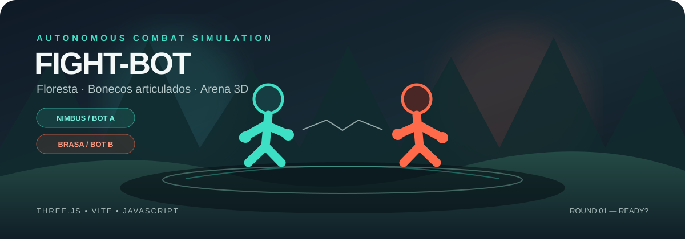

<!--
  Fight-bot | README
  Projeto: Floresta — Bonecos Articulados
-->

<div align="center">
  

  <br />

  <h1>🥊 Fight-bot</h1>
  <p><strong>Dois bots. Uma arena. Nenhum golpe roteirizado na mão.</strong></p>
  <p>Uma simulação de combate 3D em que Nimbus e Brasa escolhem suas próprias ações e lutam em uma floresta interativa.</p>

  <p>
    <a href="#-começar">🚀 Começar</a> ·
    <a href="#-como-jogar">🎮 Como jogar</a> ·
    <a href="#-tecnologias">🧰 Tecnologias</a> ·
    <a href="#-roadmap">🗺️ Roadmap</a>
  </p>

  <p>
    
    
    
    <a href="https://github.com/Nik0lasDev/Fight-bot/actions/workflows/ci.yml"></a>
    
  </p>
</div>

---

## ✨ Sobre o projeto

**Fight-bot** — apresentado dentro do jogo como **Floresta · Bonecos Articulados** — é um pequeno laboratório de combate autônomo em 3D. Dois personagens controlados por bots entram na arena, analisam a luta e executam ações sem precisar de comandos para cada golpe.

- 🟢 **Nimbus** — lutador turquesa.
- 🟠 **Brasa** — lutador coral.
- 🌲 **Arena na floresta** — cenário 3D com câmera dinâmica.
- 🧠 **Combate autônomo** — os bots escolhem golpes, fintas, esquivas e defesas.
- ❤️ **HUD de combate** — vida, intenção dos bots, rounds e placar.
- 🔊 **Áudio e efeitos** — feedback sonoro durante a luta.
- 📱 **Câmera adaptável** — enquadramento ajustado para telas verticais e horizontais.
- 🎛️ **Controles por toque** — botões na interface para pausar, retomar e iniciar uma revanche.
- ⚡ **Qualidade gráfica adaptativa** — resolução interna e sombras ajustadas para reduzir a carga em dispositivos mais limitados.
- ♻️ **Renderização otimizada** — atualizações da interface limitadas a 10 vezes por segundo, buffers reutilizados e efeitos de impacto com recursos compartilhados.
- 🌙 **Pausa em segundo plano** — a animação para quando a aba fica oculta, economizando processamento e bateria.

> O foco atual é uma simulação de combate entre bots. Não é necessário controlar cada lutador manualmente: dê início à luta e acompanhe as decisões deles.

## 🖼️ Visão geral

<div align="center">
  <table>
    <tr>
      <td align="center" width="33%">
        <h3>🌿 Arena 3D</h3>
        Cenário de floresta e câmera que acompanha o combate.
      </td>
      <td align="center" width="33%">
        <h3>🤖 Bots autônomos</h3>
        Nimbus e Brasa escolhem como agir durante a luta.
      </td>
      <td align="center" width="33%">
        <h3>🏆 Sistema de rounds</h3>
        O primeiro a vencer três rounds ganha a luta.
      </td>
    </tr>
  </table>
</div>

> **Demonstração:** ainda não há um link público de jogo hospedado configurado neste README. Siga os passos abaixo para executar localmente.

## 🚀 Começar

### Pré-requisitos

- [Node.js](https://nodejs.org/) — versão **18 ou superior** recomendada.
- [Git](https://git-scm.com/) para clonar o repositório.
- Um navegador moderno com suporte a WebGL.

### 1. Clonar o projeto

```bash
git clone https://github.com/Nik0lasDev/Fight-bot.git
cd Fight-bot
```

### 2. Instalar as dependências

```bash
npm ci
```

O comando usa o `package-lock.json` para instalar as versões registradas. Se o arquivo de lock não estiver disponível na sua cópia, use `npm install`.

### 3. Iniciar o servidor de desenvolvimento

```bash
npm run dev
```

Abra no navegador o endereço local mostrado pelo Vite — normalmente [http://localhost:5173](http://localhost:5173).

### 4. Criar uma versão de produção

```bash
npm run build
npm run preview
```

Os arquivos gerados para distribuição ficam em `dist/`. Essa pasta é criada pelo build e não precisa ser enviada ao GitHub para desenvolver o projeto.

## 🎮 Como jogar

1. Abra o jogo pelo servidor Vite.
2. Clique em **Começar simulação**.
3. Observe Nimbus e Brasa lutarem automaticamente.
4. Arraste a cena para observar a arena de outro ângulo.
5. Acompanhe as barras de vida, o placar e o registro de eventos.

| Controle | Ação |
|---|---|
| Clique em **Começar simulação** | Inicia uma nova luta |
| Arrastar a cena | Girar a câmera para observar de outro ângulo |
| `Espaço` | Pausar ou retomar a simulação |
| Botão **Pausar / Retomar** | Controlar a simulação também em celulares |
| `R` | Reiniciar o round; após o fim da luta, iniciar uma nova partida |
| Botão **Nova luta** | Começar uma revanche depois da vitória |
| Botão **Som** | Alternar o áudio |

**Condição de vitória:** o primeiro lutador a alcançar **3 rounds** vence a luta.

## 🧰 Tecnologias

| Tecnologia | Uso |
|---|---|
| [JavaScript (ES Modules)](https://developer.mozilla.org/docs/Web/JavaScript/Guide/Modules) | Lógica e organização do jogo |
| [Three.js](https://threejs.org/) | Renderização 3D, cena, câmera e personagens |
| [Vite](https://vite.dev/) | Servidor local e build de produção |
| HTML5 + CSS | Interface, HUD e estilo visual |
| WebGL | Renderização 3D no navegador |

## 📁 Estrutura do projeto

```text
Fight-bot/
├── assets/
│   └── fight-bot-banner.svg
├── .github/
│   └── workflows/
│       └── ci.yml
├── tests/
│   ├── ai.test.js
│   ├── combat.test.js
│   ├── math.test.js
│   └── physics.test.js
├── src/
│   ├── fighter/
│   │   ├── bot.js          # Decisões e perfis dos bots
│   │   └── fighter.js      # Personagens e estado dos lutadores
│   ├── arena.js            # Arena, câmera e iluminação
│   ├── audio.js            # Áudio do jogo
│   ├── combat.js           # Golpes, colisões e nocautes
│   ├── forest.js           # Floresta e interação com o cenário
│   ├── main.js             # Inicialização e loop principal
│   └── style.css           # Interface e estilos
├── index.html
├── package.json
├── package-lock.json
└── README.md
```

## 🗺️ Roadmap

O roadmap abaixo é uma lista de ideias para evolução — não significa que todos esses recursos já estejam implementados.

- [x] Arena 3D no navegador
- [x] Dois lutadores controlados por bots
- [x] Vida, placar e rounds
- [x] Câmera com controle de órbita
- [x] Efeitos sonoros
- [ ] Opções de dificuldade e perfis de IA
- [ ] Tela de configurações e acessibilidade
- [ ] Mais arenas e personagens
- [ ] Melhorias de desempenho em dispositivos móveis
- [ ] Publicação de uma demonstração online

## 🧪 Testes e validação

Execute os testes automatizados e a compilação de produção com um único comando:

```bash
npm run check
```

Ou execute cada etapa separadamente:

```bash
npm test
npm run build
```

O GitHub Actions executa essas verificações em pushes para `main` e em Pull Requests direcionados a `main`. Os testes cobrem utilitários matemáticos, interpolação de articulações, limites de pose, validação de membros, catálogos de movimentos da IA, colisões e limites da arena.

O workflow de qualidade está configurado para executar automaticamente no GitHub Actions em cada push para `main` e em Pull Requests direcionados a essa branch.

## 🧩 Solução de problemas

<details>
  <summary><strong>O navegador mostra uma tela vazia ou a simulação não inicia</strong></summary>

  - Confirme que as dependências foram instaladas com `npm ci`.
  - Inicie o servidor com `npm run dev`.
  - Acesse a URL exibida no terminal, em vez de abrir `index.html` diretamente como arquivo.
  - Verifique se o navegador oferece suporte a WebGL.
</details>

<details>
  <summary><strong>O comando npm não é reconhecido</strong></summary>

  Instale o Node.js pelo site oficial: [nodejs.org](https://nodejs.org/). Depois, feche e abra novamente o terminal e confira:

  ```bash
  node --version
  npm --version
  ```
</details>

<details>
  <summary><strong>Preciso enviar a pasta node_modules para o GitHub?</strong></summary>

  **Não.** Ela é instalada localmente com `npm ci` e já deve ficar ignorada pelo Git. Mantenha no repositório o `package.json` e o `package-lock.json`, que descrevem as dependências do projeto.
</details>

## 🤝 Contribuir

Ideias, sugestões e correções são bem-vindas!

1. Faça um fork do repositório.
2. Crie uma branch para sua alteração.
3. Faça mudanças pequenas e teste com `npm run build`.
4. Abra um Pull Request descrevendo o que mudou.

## 📄 Licença

Nenhuma licença foi identificada neste README. Se você pretende permitir reutilização ou contribuições públicas, considere adicionar um arquivo `LICENSE` com os termos escolhidos.

---

<div align="center">
  <p><strong>Feito para explorar combate autônomo em 3D. 🤖🌲</strong></p>
  <p><a href="#-começar">Voltar ao início ↑</a></p>
</div>
